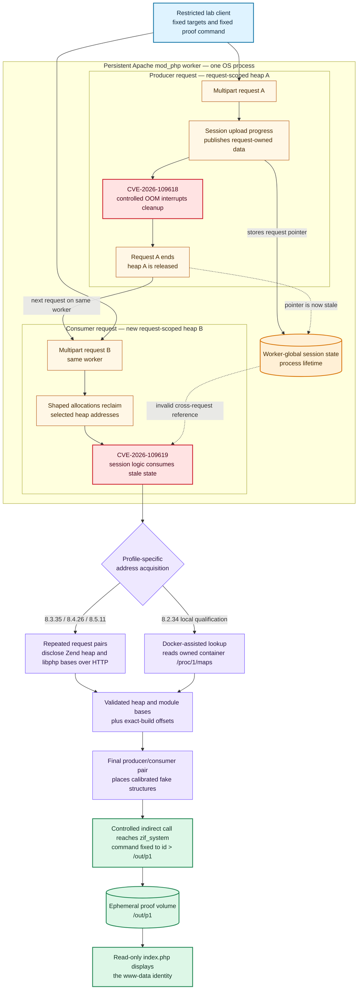
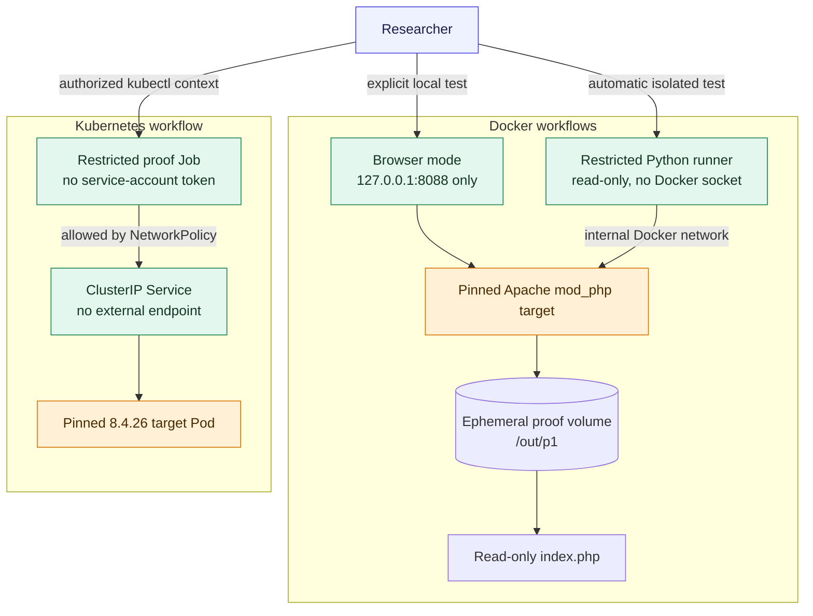

# PHP2Shell: a reproducible PHP request-lifecycle RCE lab

<p align="center">
  
</p>

<p align="center"><em>Two requests, one persistent worker, and request-owned state that survives too long.</em></p>

This repository is a reproducible, local-only research lab for two related PHP
request-lifecycle vulnerabilities:

- [CVE-2026-109618 / GHSA-w8hw-w9fx-j79w](https://github.com/php/php-src/security/advisories/GHSA-w8hw-w9fx-j79w): remote code execution through out-of-memory corruption.
- [CVE-2026-109619 / GHSA-6wmf-4rv5-p3rp](https://github.com/php/php-src/security/advisories/GHSA-6wmf-4rv5-p3rp): remote code execution through stale worker-global state.

The official PHP advisories rate both issues **critical**, with a CVSS 4.0
score of **9.2**. This lab reproduces a combined session-upload-progress/OOM
path against four exact official Apache Docker images. It is intentionally not
a scanner: the destination allowlist and proof command are fixed in source.

> [!CAUTION]
> Use this repository only in the included isolated lab or on systems you own
> and have explicitly authorized for testing. Never run it against a production
> PHP or REDCap deployment.

## Executive summary

| Item | Finding |
| --- | --- |
| Security boundary | Unauthenticated HTTP request to PHP worker execution |
| Confirmed impact | Command execution with the web worker's privileges |
| Demonstrated SAPI | Apache `mod_php` with prefork workers |
| Trigger | Multipart parsing, session upload progress, and controlled OOM |
| Cross-request requirement | Producer and consumer reach the same persistent worker |
| Tested architecture | Exact pinned `linux/amd64` official Docker images |
| Proof command | Fixed to `id>/out/p1` |
| Exposure | Loopback or container-internal networking only |
| Complete remediation | Upgrade to a PHP release containing both fixes |

The visible success condition is deliberately simple:

```text
php-lab: updated by the PoC
uid=33(www-data) gid=33(www-data) groups=33(www-data)
```

The exploit does not modify the web application. It writes the worker identity
to an isolated proof volume, and a read-only `index.php` displays that file.

## Quick start

This short path runs the default PHP 8.4.26 browser lab on an x86-64 Linux
host with Docker Compose v2, Python 3, and `curl`. It binds the vulnerable
container only to `127.0.0.1:8088`.

```bash
git clone https://github.com/cbovin/php2shell-poc.git
cd php2shell-poc
./start-page.sh 8.4.26
```

Open <http://127.0.0.1:8088/> and verify that it displays `php-lab`. In a
second terminal, from the same repository directory, run the restricted proof:

```bash
python3 poc.py 127.0.0.1:8088
```

Refresh the page. A successful run adds the `www-data` identity shown above.
Remove the containers and ephemeral proof volume when finished:

```bash
./stop-page.sh
```

For preflight checks, alternative PHP versions, automatic matrix testing, and
Kubernetes instructions, see [Setup and reproduction](#setup-and-reproduction).

## How the vulnerability chain works

The lab combines the two related failure modes. CVE-2026-109618 supplies an
unsafe interruption: the former OOM `longjmp()` path could leave request state
partially initialized before shutdown. CVE-2026-109619 supplies the
cross-request lifecycle error: worker-global state can retain pointers into a
request heap after that heap has been released.

### Vulnerability-chain architecture

Read the diagram from top to bottom. Solid arrows represent HTTP or execution
flow; dashed arrows represent the invalid pointer lifetime that crosses the
request boundary. The two red nodes identify where each CVE contributes to the
combined chain.



> [!NOTE]
> **Broken lifetime invariant:** once request A ends, no pointer into heap A
> should remain reachable from process-lifetime worker state. The combined chain
> becomes possible because that reference survives long enough to be interpreted
> after request B reuses the address.

The sequence has six important stages:

1. **Publish state.** Multipart session upload-progress handling stores
   request-owned data in state retained by the worker.
2. **Interrupt cleanup.** A controlled allocation failure exits processing
   while matching state cleanup is incomplete.
3. **Cross the request boundary.** PHP releases the request heap, but a stale
   reference remains reachable by the persistent worker.
4. **Reclaim the memory.** A second multipart request handled by that worker
   places chosen layouts into the freed heap slots.
5. **Resolve addresses.** The HTTP-only profiles disclose the Zend heap and
   `libphp.so` bases. PHP 8.2.34 uses a clearly labeled local Docker-assisted
   lookup because its branch clears the relevant cookie-send state.
6. **Prove control.** A calibrated fake structure reaches `zif_system` with one
   immutable command that writes `/out/p1`; Apache may replace the crashed
   child, and the replacement serves the proof page.

This is a combined reproduction path, not a claim that the script is a minimal
independent test for each CVE. See the [technical deep dive](docs/TECHNICAL.md)
for the heap disclosures, profile offsets, ASLR qualification, and SAPI limits.

### Why the same worker matters

The producer request leaves stale state in a long-lived PHP worker. The consumer
request must later reach that worker before ordinary initialization replaces the
state. The lab uses one Apache prefork child to make this deterministic.
Additional production workers can reduce per-request reliability, but they do
not remediate the underlying condition.

### What a successful run proves

A successful run demonstrates command execution as the web worker in the exact
pinned image, architecture, SAPI, and deliberately vulnerable configuration.

A failed run does **not** demonstrate safety. Worker scheduling, extensions,
build flags, frontend normalization, heap noise, or different symbol offsets
can break this build-specific PoC while the installed PHP version remains
affected. Patch decisions must use package inventory and vendor security status,
not PoC success or failure.

## Affected and fixed versions

Both official advisories publish the same maintained-branch thresholds:

| PHP branch | Advisory range | First patched release | Exact vulnerable image tested here |
| --- | --- | --- | --- |
| 8.2 | `< 8.2.35` | **8.2.35** | `php:8.2.34-apache` |
| 8.3 | `< 8.3.36` | **8.3.36** | `php:8.3.35-apache` |
| 8.4 | `< 8.4.27` | **8.4.27** | `php:8.4.26-apache` |
| 8.5 | `< 8.5.12` | **8.5.12** | `php:8.5.11-apache` |

These are PHP core issues, not REDCap-specific vulnerabilities. Reachability
and reliability depend on the SAPI, worker lifecycle, application, extensions,
frontend behavior, configuration, binary build, and heap layout. Older
unsupported branches are not safe by omission; migrate them to a maintained
branch containing both fixes.

## Reproduced compatibility matrix

| Exact image | Address-resolution mode | Docker | Kubernetes |
| --- | --- | --- | --- |
| `php:8.2.34-apache` | Docker-assisted local lookup | Verified | Not implemented |
| `php:8.3.35-apache` | HTTP-only leak chain | Verified | Not implemented |
| `php:8.4.26-apache` | HTTP-only leak chain | Verified | Verified |
| `php:8.5.11-apache` | HTTP-only leak chain | Verified | Not implemented |

The profiles are calibrated for immutable `linux/amd64` official-image
digests. Native Ubuntu packages, FPM images, ARM builds, alternative extension
sets, and other vendor binaries can have different symbols and heap geometry.
This script is not calibrated for those environments.

### PHP 8.2.34 qualification

PHP 8.2.34 clears `send_cookie` after the producing request, preventing the
same in-band address disclosure used by the newer profiles. Its local workflow
therefore verifies the exact image and reads the Zend heap and `libphp.so` bases
from `/proc/1/maps` inside the Docker container owned by the researcher. Only
those two addresses are passed to the restricted runner.

The 8.2 profile proves the vulnerable corruption and controlled-call primitive
in this lab. It does not demonstrate an ASLR-independent remote exploit.

## Lab isolation model



Safety controls are part of the research result, not optional decoration:

- Accepted targets are hard-coded to `target:80`, `127.0.0.1:8088`, and
  `localhost:8088`.
- The payload is fixed in source and cannot be supplied on the command line.
- Browser mode binds only to loopback; automatic Docker mode publishes no port.
- The runner drops all Linux capabilities, has a read-only root filesystem, and
  never receives the Docker socket.
- Kubernetes uses a ClusterIP-only Service and limits target ingress to the
  labeled proof Job.
- Target and runner images are pinned by digest, and PHP versions are checked at
  runtime.
- No REDCap files, data, credentials, or production networks are involved.

## Setup and reproduction

### 1. Prerequisites

- x86-64 (`linux/amd64`) Linux host;
- Docker Engine with Docker Compose v2;
- Python 3 and `curl` on the host; and
- TCP port `8088` available on loopback for the browser workflow.

The Kubernetes workflow additionally requires `kubectl`, access to an
explicitly authorized cluster, and permission to create and delete the
dedicated `php-rce-lab` namespace. Docker Desktop may be able to run the
images through amd64 emulation on another architecture, but that configuration
was not tested and is outside this lab's claims.

### 2. Clone and validate the lab

```bash
git clone https://github.com/cbovin/php2shell-poc.git
cd php2shell-poc
./tests/static.sh
```

The static check does not execute the exploit. It runs the unit tests, compiles
the Python sources, checks shell syntax, renders the Compose configuration when
Docker is available, and checks the Git diff for whitespace errors.

### 3. Browser workflow

Start one exact profile. PHP 8.4.26 is the default. The launcher pulls the
immutable image digest recorded in `versions.sh`, creates a fresh proof volume,
binds Apache only to `127.0.0.1:8088`, and verifies the PHP version and initial
page before returning:

```bash
./start-page.sh 8.4.26
```

Open <http://127.0.0.1:8088/> and confirm the initial response:

```text
php-lab
```

From another terminal, run:

```bash
python3 poc.py 127.0.0.1:8088
```

Refresh the page to see the proof, then remove the lab:

```bash
./stop-page.sh
```

Use `8.2.34`, `8.3.35`, or `8.5.11` as the argument to test another supported
profile. `poc.py` reads the target's `X-Powered-By` header and rejects a profile
mismatch.

### 4. Automatic Docker workflow

Run one version with automatic cleanup:

```bash
./run.sh 8.4.26
```

Run the entire supported matrix:

```bash
./tests/integration.sh
```

The automation pulls immutable images, requires the initial `php-lab` response,
restarts Apache for a clean worker state, runs the proof, requires the updated
page, and removes its containers, network, and volume.

### 5. Kubernetes workflow

The Kubernetes workflow currently covers only the HTTP-only 8.4.26 profile:

```bash
./k8s/deploy-and-test.sh
```

Inspect the completed result:

```bash
kubectl -n php-rce-lab get deployment,pod,service,job,networkpolicy
kubectl -n php-rce-lab logs job/php-rce-proof
```

Remove the dedicated namespace when evidence collection is complete:

```bash
kubectl delete namespace php-rce-lab
```

This workflow was verified on MicroK8s v1.36.2 on an amd64 Ubuntu 24.04.4 node.

## Mitigation priorities

Upgrade is the only complete mitigation identified by both official advisories.
Use at least PHP **8.2.35**, **8.3.36**, **8.4.27**, or **8.5.12** for the
corresponding maintained branch, then restart every Apache, PHP-FPM, container,
pod, or other long-lived PHP worker.

| Priority | Action | Important limitation |
| --- | --- | --- |
| Required | Upgrade to a release containing both fixes | The only complete mitigation |
| Temporary | Set `session.upload_progress.enabled=Off` administratively | Breaks the demonstrated session path, not every stale-state path |
| Temporary | For the OOM advisory, assess administratively enforced `memory_limit=-1` | Counterintuitive, removes a resource guard, and is not complete |
| Temporary | On affected PHP 8.5, set `fatal_error_backtraces=0` | Covers one confirmed producer only |
| Defense in depth | Enforce decoded body, multipart, header, nesting, upload, and timeout limits before PHP | Reduces exposure and DoS risk but does not patch PHP |

The `memory_limit=-1` workaround has significant operational consequences and
must not be copied blindly. Read [Mitigations and deployment
checklist](docs/MITIGATIONS.md) for the official caveats, restart requirements,
FPM considerations, and compensating controls.

## Testing and evidence

The full Docker matrix was reproduced on October 21, 2026. All four browser
workflows and all four isolated `run.sh` workflows reached the `www-data` proof.
The 8.4.26 Kubernetes workflow succeeded repeatedly on freshly rolled Pods.

Run the non-exploit checks with:

```bash
./tests/static.sh
```

They cover unit tests, Python compilation, shell syntax, Compose rendering, and
repository whitespace. Exact image digests, test procedure, expected worker
behavior, and exclusions are recorded in [Testing and reproduced
results](docs/TESTING.md).

## PoC limitations

This proof is intentionally narrow. Its limits are part of the result and
should be stated alongside any screenshot, demonstration, or article based on
the repository.

| Limitation | Consequence for interpretation |
| --- | --- |
| Exact-build profiles | Offsets and heap layouts are calibrated only for the four pinned official Docker image digests. A nearby tag or vendor rebuild can fail even when its PHP version is affected. |
| One demonstrated SAPI | The tested path uses Apache `mod_php` with a prefork worker. It does not establish exploitability for PHP-FPM, CGI, FrankenPHP, LSAPI, or other worker models. |
| One architecture | Only `linux/amd64` was validated. ARM and other architectures are unsupported. |
| Deliberately stable worker layout | The lab constrains Apache to one worker to make the cross-request handoff reproducible. Real worker pools, extensions, requests, and allocator noise can materially change reliability. |
| Combined reproduction | The script exercises a combined session-upload-progress/OOM chain. It is not an independent minimal test that attributes command execution to each CVE in isolation. |
| Qualified PHP 8.2 profile | The 8.2.34 workflow obtains two address bases from `/proc/1/maps` in the researcher's own Docker container. It does not prove a remote, ASLR-independent 8.2 exploit. |
| Fixed destination and payload | The allowlist contains only the included local/container targets, and the command is fixed to `id>/out/p1`. This is a safety control, not a general exploitation framework or scanner. |
| Negative results are non-diagnostic | Failure can mean a profile mismatch, different build, worker scheduling, frontend normalization, or heap noise. It does not prove that a PHP installation is patched. |
| Vulnerable releases only | The lab does not attempt to exploit fixed releases. Patch verification should use version/package inventory and vendor advisories, followed by a complete worker restart. |
| Deliberately vulnerable configuration | Session upload progress, memory limits, and worker settings are selected to expose the research path; they are not production hardening guidance. |
| Limited Kubernetes matrix | Only the pinned PHP 8.4.26 profile was validated in Kubernetes. The other profiles are Docker-only in this repository. |

Native Ubuntu, Debian, RHEL, and third-party PHP packages were not calibrated or
tested. The official advisories discuss additional confirmed and conditional
SAPI paths, so their security scope is broader than this reproduction script.

## Documentation map

| Document | Purpose |
| --- | --- |
| [Technical explanation](docs/TECHNICAL.md) | Request lifecycle, disclosures, fake structures, ASLR, and SAPI boundaries |
| [Mitigations](docs/MITIGATIONS.md) | Upgrade guidance, temporary controls, caveats, and deployment checklist |
| [Testing](docs/TESTING.md) | Exact digests, environments, procedures, results, and exclusions |
| [References](docs/REFERENCES.md) | Official advisories, manuals, packaging, and upstream technique |
| [Publication checklist](docs/PUBLICATION_CHECKLIST.md) | Legal, safety, credential, evidence, and claim review before release |
| [Security policy](SECURITY.md) | Intended use and private reporting guidance |
| [Attribution notice](NOTICE.md) | Research credits, provenance, and redistribution status |
| [Article artwork](assets/README.md) | Generated image provenance and final prompt |

## Repository layout

| Path | Purpose |
| --- | --- |
| `poc.py` | Version-profiled, local-target-only proof |
| `versions.sh` | Supported versions and immutable image references |
| `compose.yaml` | Isolated target and restricted Python runner |
| `start-page.sh`, `stop-page.sh` | Persistent loopback browser workflow |
| `run.sh` | One-version Docker integration test with cleanup |
| `tests/` | Unit/static checks and complete Docker matrix runner |
| `k8s/` | ClusterIP-only 8.4.26 deployment and proof Job |
| `target/` | Minimal Apache, PHP, and read-only page configuration |
| `assets/` | Article artwork and generation provenance |

## Attribution and publication status

Official advisory credits and the upstream exploit-technique attribution are
preserved in [NOTICE.md](NOTICE.md).

> [!IMPORTANT]
> The derived exploit implementation traces to an upstream repository that had
> no license at the referenced revision. Resolve permission or replace it with
> independently reviewed, appropriately licensed code before public
> redistribution. Adding a license here would not grant rights to upstream
> material.

No repository content should be interpreted as authorization to test a system
you do not own or have explicit permission to assess.
